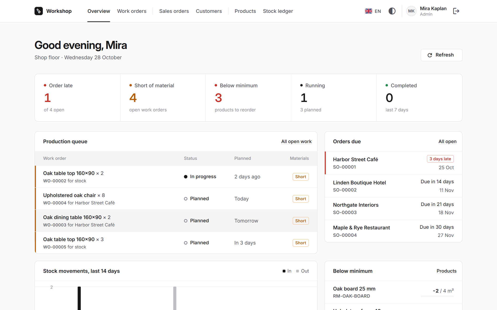
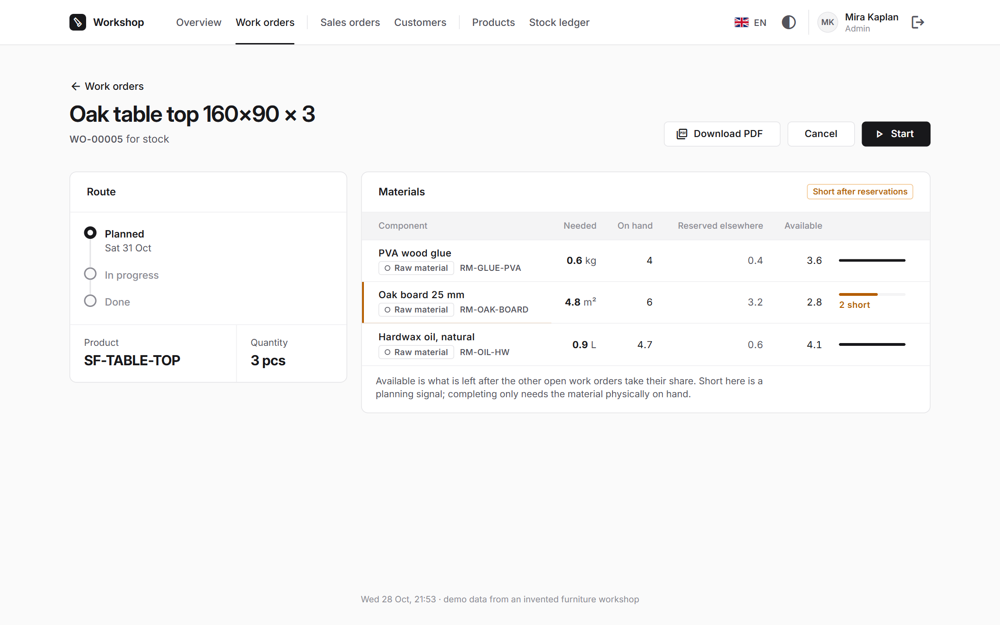
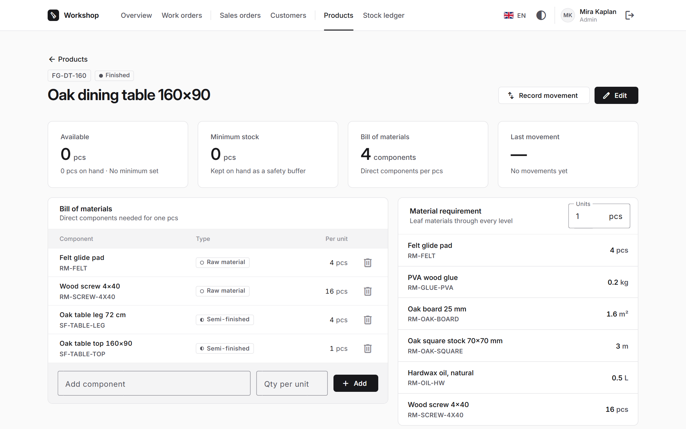
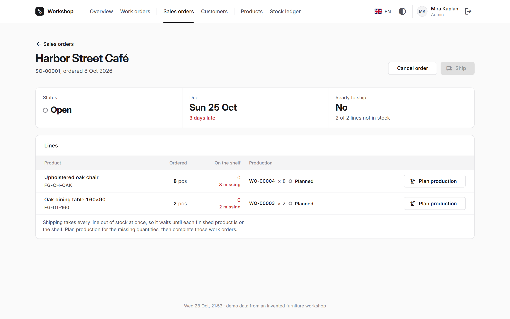
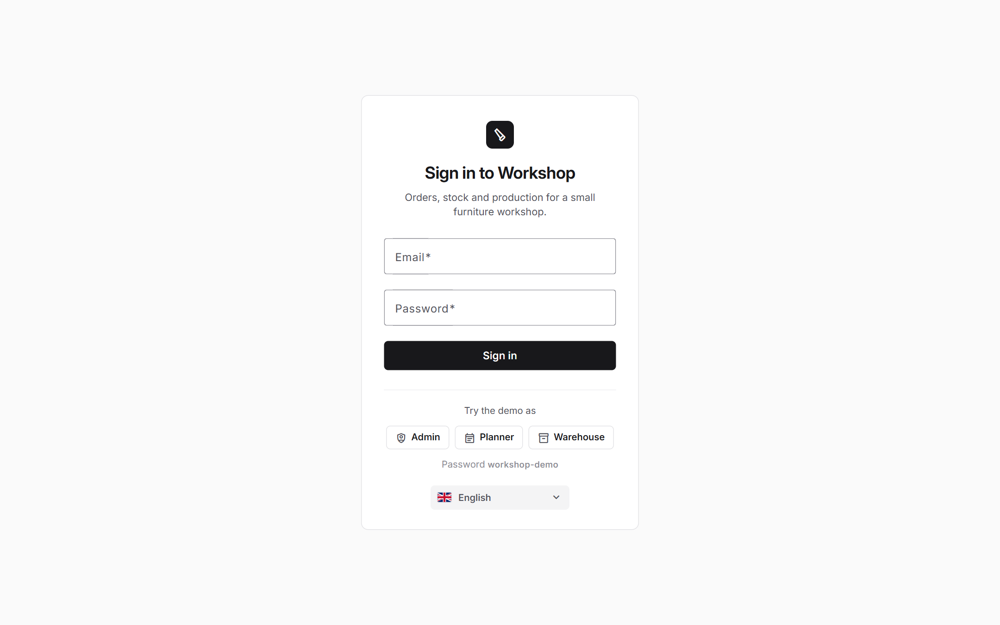
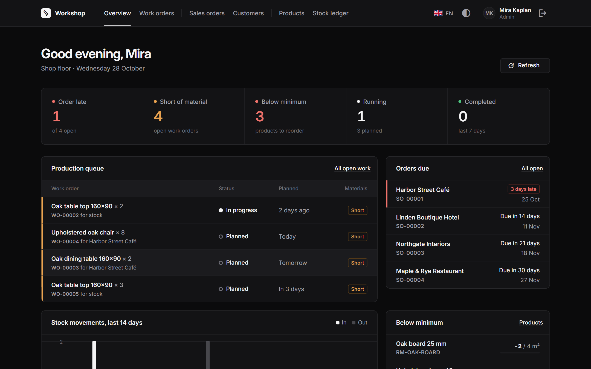

# Order & Inventory Panel

Order, inventory and production tracking for small manufacturers: furniture, textile or metal workshops with
10–50 people that run on Excel today. It goes past a plain stock list. Products have a **multi-level bill of
materials**, and every work order shows **which materials are short once the other open work orders take
their share**.

> **Live demo:** https://order-inventory-client.onrender.com. Pick a role on the sign-in page and you are in.
> The demo data (an invented furniture workshop) is reset every night at 03:00 UTC, so feel free to ship,
> complete and cancel things. Free hosting: the first load after a quiet period can take up to a minute.



## What it does

| | |
| --- | --- |
| **Bill of materials** | Raw materials, semi-finished parts and finished goods. Multi-level BOMs, cycle check (A→B→A is rejected), material requirement through every level for *N* units. |
| **Stock ledger** | On-hand is never stored: it is the sum of an append-only ledger (receipts, issues, adjustments, production). Stock can never go negative, even under concurrent requests. |
| **Work orders** | The BOM is snapshotted when the work order is created. Each component shows on hand, reserved by other open work orders, available and short. Completing consumes the materials and adds the product in one transaction. |
| **Sales orders** | Late orders are flagged. *Plan production* creates a work order from an order line. *Ship* takes every line out of stock at once, or nothing. |
| **Dashboard** | Late orders, work orders short of material, products below minimum (on available, not just on hand), the production queue and a weekly production chart. |
| **Outputs** | Work order PDF, Excel export of every list, Excel import of products and opening stock (preview first, all or nothing). |
| **Roles** | Admin, Planner and Warehouse, each seeing only the actions it may take. The API enforces every permission. |
| **Everything else** | Light and dark theme, works from a phone (390px) up to a wide screen, six languages (English, Turkish, German, French, Spanish, Italian). |

| Material shortage after reservations | Multi-level bill of materials |
| --- | --- |
|  |  |
| **Sales order: late, not ready to ship** | **One-click demo sign-in** |
|  |  |



## The rules that matter

- **Reservation:** two work orders that need the same 5 m² of oak board must not both report it as available.
  `Available = On hand − Reserved by other open work orders`, and *short* is what is missing after that.
- **Locking:** every stock-changing operation runs in one database transaction and locks the affected product rows
  (`SELECT … FOR UPDATE`, in id order, so two operations cannot deadlock). The "is there enough?" check happens
  inside the lock. An integration test fires two concurrent operations at the same product.
- **Append-only ledger:** mistakes are corrected with an adjustment, never by editing history. This is enforced
  in the application and by a database trigger.

## Tech stack

| Area | Technology |
| --- | --- |
| API | .NET 10 Web API, EF Core 10, PostgreSQL (Npgsql) |
| Client | Angular 22 (standalone components, signals), Angular Material, Chart.js |
| Auth | JWT bearer tokens with roles |
| Documents | QuestPDF (PDF), ClosedXML (Excel) |
| Tests | xUnit, Testcontainers (real PostgreSQL for integration tests) |
| CI / hosting | GitHub Actions; Render (API in Docker, static client), Neon (PostgreSQL) |

```
api/
  src/OrderInventory.Domain          Entities and pure domain logic (BOM explosion, availability, transitions)
  src/OrderInventory.Application     Use-case services and DTOs
  src/OrderInventory.Infrastructure  EF Core, migrations, PDF and Excel
  src/OrderInventory.Api             Controllers, auth, composition root
  tests/                             Unit tests and integration tests
client/src/app/
  core/       API, auth, translations, theme
  features/   dashboard, products, stock, orders, work-orders
```

Dependencies point inward: the Domain layer depends on nothing.

## Run it locally

You need the [.NET 10 SDK](https://dotnet.microsoft.com/download), [Node.js 22+](https://nodejs.org/) and
[Docker Desktop](https://www.docker.com/products/docker-desktop/).

```bash
cp .env.example .env              # database credentials; change them if you like
docker compose up -d              # PostgreSQL on 5432

cd api
dotnet run --project src/OrderInventory.Api   # http://localhost:5080, migrates and seeds the demo data

cd ../client
npm install
npm start                         # http://localhost:4200, /api is proxied to the API
```

Sign in with one of the demo roles on the login page (password `workshop-demo`).
`docker compose down -v` resets the database to the seed.

If you change the credentials in `.env`, update the connection string in
`api/src/OrderInventory.Api/appsettings.Development.json` too, or override it with
`dotnet user-secrets set "ConnectionStrings:Default" "<connection-string>" --project src/OrderInventory.Api`.

## Tests

```bash
cd api
dotnet test        # Docker must be running: integration tests start a throwaway PostgreSQL
```

After changing an entity, add a migration (a test fails if the model has changes no migration covers):

```bash
cd api
dotnet tool restore
dotnet ef migrations add <Name> -p src/OrderInventory.Infrastructure -s src/OrderInventory.Api -o Persistence/Migrations
```
